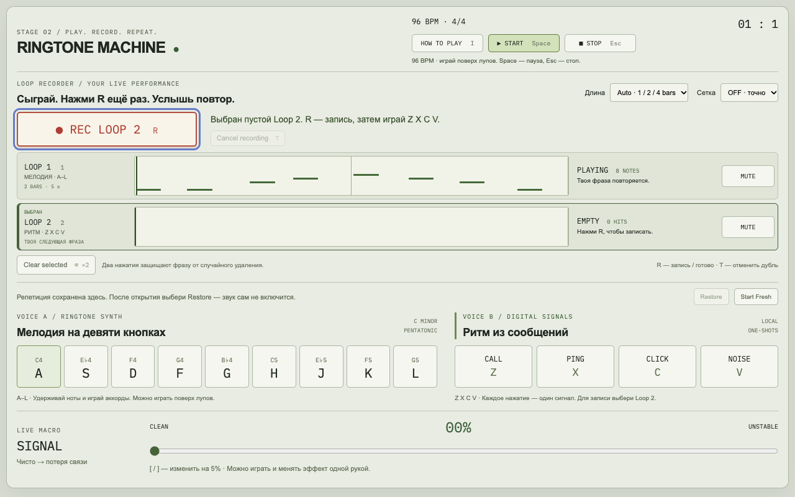

# Scenario A — A A D F | G F D A

30 октября 2026. OFF, 96 BPM, Auto. Каждый вариант исполнен через реальные keyboard events в Chrome; production recorder и Tone.js не подменялись.

| Вариант | Raw | Saved | Scheduled / цикл | DOM / видимые | Длина | Ошибка интервалов capture → playback | Ошибка атак фактического PCM |
| --- | ---: | ---: | ---: | ---: | --- | ---: | ---: |
| Первый луп, остановленный Transport | 8 | 8 | 8 | 8 / 8 | 2 bars / 5 s | ≤ 0.1 ms | 5.5 ms |
| Уже работающий Transport | 8 | 8 | 8 | 8 / 8 | 2 bars / 5 s | ≤ 0.2 ms | native timestamps |
| Promise resume задержан на 2.2 s | 8 | 8 | 8 | 8 / 8 | 2 bars / 5 s | ≤ 0.1 ms | native timestamps |
| Неравномерные интервалы | 8 | 8 | 8 | 8 / 8 | 2 bars / 5 s | ≤ 0.1 ms | 4.2 ms |

Сохранённый и запланированный порядок во всех вариантах: **C4, C4, F4, G4, B♭4, G4, F4, C4**. Длительности взяты из фактических keyup; ни одна нота не объединена с соседней. Ручные и loop-инструменты имеют одинаковые oscillator/ADSR/volume/velocity. В стабильной готовой аудиосистеме все восемь ручных атак также присутствуют.

Точность PCM оценена по окнам огибающей 20 ms с шагом 10 ms; это грубее точности планирования. После последнего изменения (100 ms запаса для Transport и немедленный ручной звук) максимальные акустические отклонения — **5.5 ms** и **4.2 ms**, ниже цели 20–30 ms. При предыдущем 25 ms запасе в одном прогоне было 29.9 ms: именно поэтому запас увеличен. Note timestamps не сдвигались для подгонки результата.

## Реальные артефакты

- [PCM-выход ровной фразы](scenario-a-playback.wav) — восемь аудиоатак одного цикла.
- [PCM-выход неравномерной фразы](scenario-a-expressive-playback.wav).
- [Trace input / saved / native scheduling](scenario-a-trace.json) — точные timestamps, pitches, gates и counts.
- [Скриншот восьми видимых блоков](scenario-a-timeline.png).

Запись получена из настоящего выхода Web Audio через MediaRecorder. Для анализа выделен один период по известным origin/длине; предшествующий ручной Release и уже буферизованное начало следующего периода не входят в сравнение. Ноты не создавались прямым заполнением массива вместо игры. Эти тестовые WAV не загружаются инструментом.

## До исправления

С теми же восемью нажатиями предыдущая версия показывала 8 saved / 8 DOM, но C4 обрезался и видимыми были только 5 блоков. При задержке первого resume на 2.2 s до recorder доходили только последние 4 нажатия, поэтому получался 1 bar. По умолчанию включённая 1/8 также меняла свободные интервалы. Точное состояние пользовательского скриншота не реконструировалось без его event store; причины проверены независимо воспроизводимыми тестами.

## Быстрая ручная проверка

Обновить страницу → Start Fresh → OFF / Auto / SIGNAL 0 → дождаться готовности аудио → R → A A D F | G F D A примерно по четвертям → R. Ожидаются 2 BARS, 8 NOTES и восемь видимых блоков. Затем записать Z X C V вторым слоем и поиграть поверх. Слишком длинное удержание или большая начальная пауза могут обоснованно увеличить Auto до 4 bars: время оценивается по всей фразе, а не по одному числу нот.
